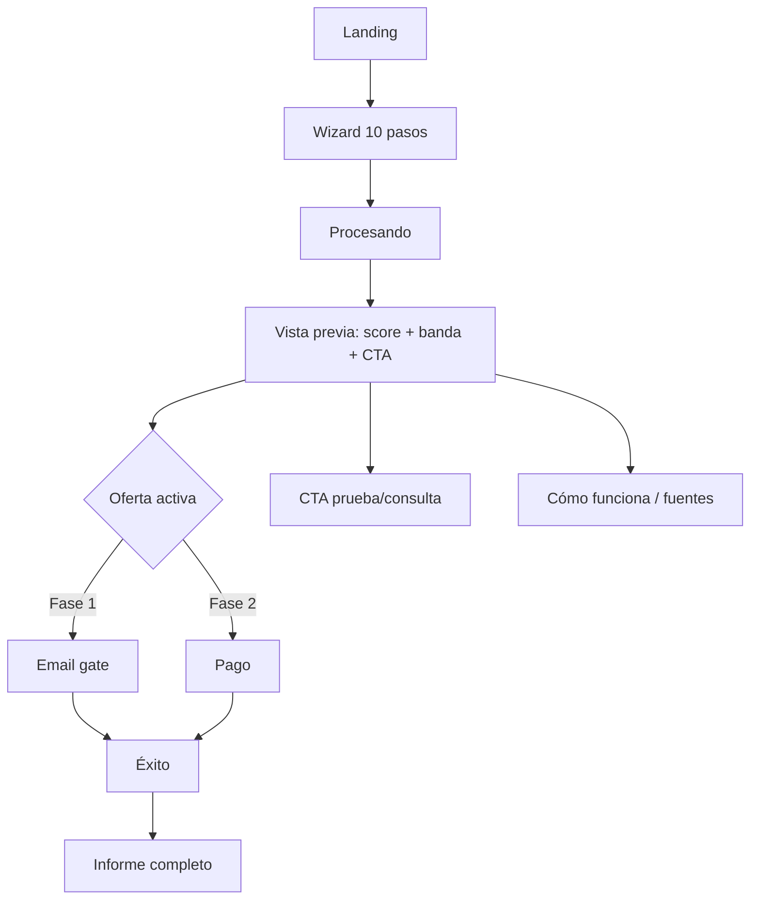
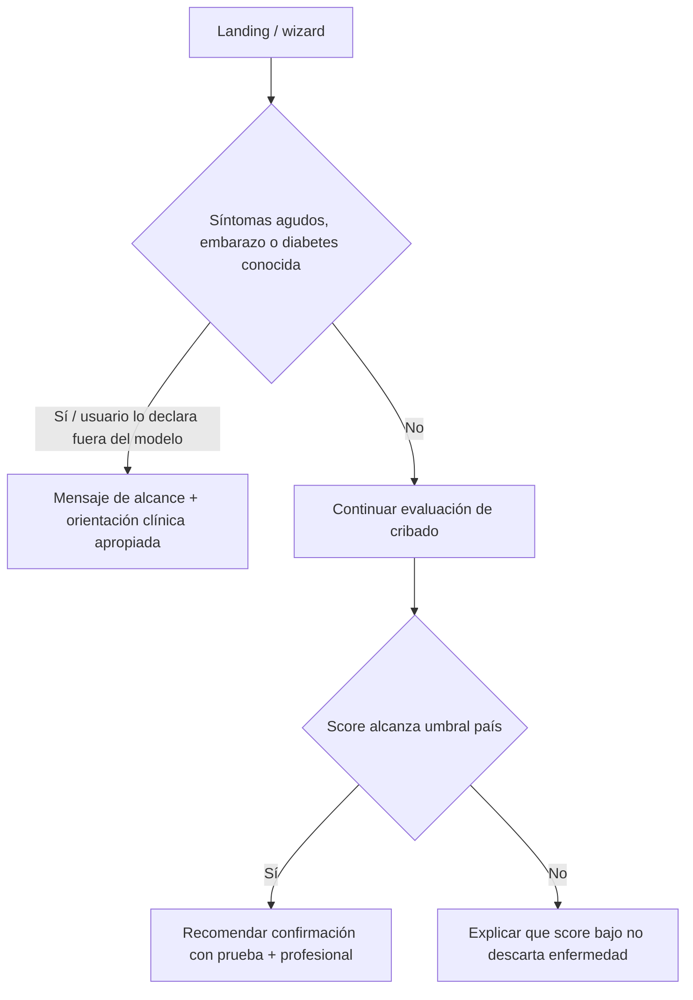
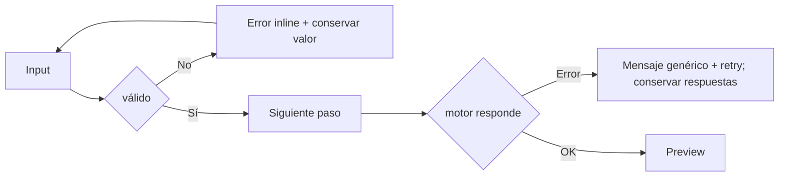

# Sitemap, rutas y flujos

## Rutas públicas
- `/` Landing.
- `/calcular` shell del wizard; pasos en URL estable `/calcular/:step` para permitir volver sin perder contexto de sesión.
- `/procesando`
- `/resultado` vista previa gratuita.
- `/informe/solicitar` email gate de fase 1; `/pago` checkout de fase 2.
- `/exito`
- `/informe/:report_id`
- `/como-funciona`
- `/faq`
- `/fuentes`
- `/legal/privacidad`, `/legal/terminos`, `/legal/aviso-medico`, `/legal/cookies`
- `/admin` autenticado; QA, configuración de perfiles país, pricing, fuentes, analytics agregados.

## SEO localizado
Patrón: `/{locale}/{country}/{use_case}`. Ejemplos:
- `/es/mx/calculadora-riesgo-diabetes`
- `/es/pe/test-findrisc`
- `/pt/br/risco-diabetes-tipo-2`
- `/en/us/diabetes-risk-score`
Casos de uso permitidos: `calculadora-riesgo-diabetes`, `test-findrisc`, `debo-hacerme-prueba-diabetes`, `cintura-imc-riesgo`. No crear páginas que prometan diagnóstico o predicción glucémica personalizada.

## Flujo principal

## Flujo de seguridad

## Flujo de errores

## Admin
El admin nunca muestra respuestas individuales salvo necesidad operacional autorizada. Paneles por defecto: volumen, funnel, país, estado de fuentes, versión de motor, paridad de tests, incidencias. Cualquier vista con datos identificables requiere rol explícito, auditoría y motivo.
